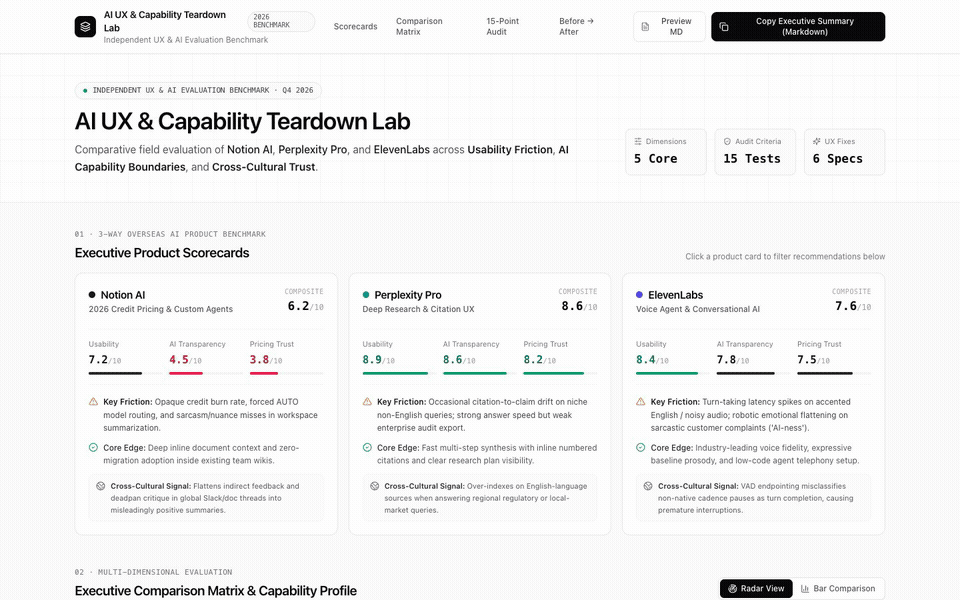

# AI UX & Capability Teardown Lab

[打开在线工作台](https://ai-ux-teardown-lab.vercel.app/) · [下载 30 秒录屏](public/media/portfolio-walkthrough.mp4)

## 项目定位

面向 AI 产品经理、用户研究与评测团队的竞品体验拆解工作台。用统一的能力与体验维度横向比较 Notion AI、Perplexity Pro 和 ElevenLabs，再把检查中的具体摩擦点转成可讨论、可验证的改版方案。

## 功能架构

| 模块 | 可操作能力 |
|---|---|
| Executive Product Scorecards | 浏览三个产品的关键指标、相对优势和体验短板。 |
| Side-by-Side Benchmark Matrix | 对照使用门槛、证据溯源、时延、定价可预测性和 AI 能力等五个维度。 |
| Capability Footprint | 切换雷达图和分组柱状图，查看同一量表下的能力轮廓与差距。 |
| 15-Point AI Capability & UX Checklist | 按类别和结果筛选检查项，展开详细评估，查看通过、部分通过与失败的分布。 |
| Before → After Redesign | 按产品浏览 6 项改版建议，对照当前流程、拟议改动、设计理由与预期验证指标。 |
| Executive Summary | 预览 Markdown 摘要并复制，便于提交评审或纳入研究记录。 |

## 建议体验路径

先用三方矩阵定位差距，再在检查清单筛选「Transparency & Grounding」，回看对应的评估记录。最后按产品切换改版建议，将发现转成下一轮可验证的改动。

评测分数用于同一量表下的对照，改版影响指标用于设计后续验证。
